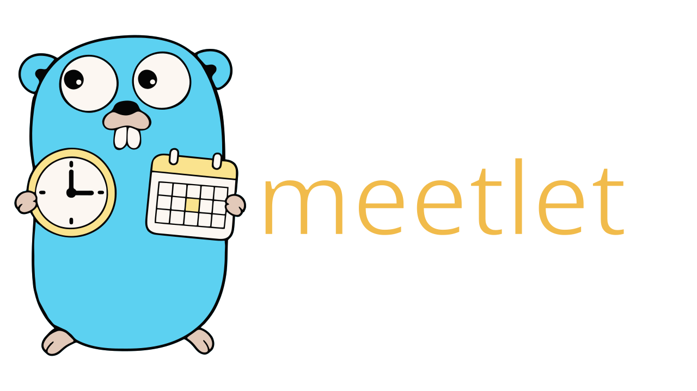

_Go gopher by [Renée French](https://go.dev/blog/gopher),
[CC BY 4.0](https://creativecommons.org/licenses/by/4.0/); adapted for Meetlet_.

A small meeting planner for your terminal, built with Go and Charm's
[Bubble Tea](https://github.com/charmbracelet/bubbletea),
[Bubbles](https://github.com/charmbracelet/bubbles), and
[Lip Gloss](https://github.com/charmbracelet/lipgloss).

Pick a **date, local time, and source location**. Meetlet shows the same instant
everywhere else, including each location's local date, UTC offset, and clock
changes. Export a calendar event to import into Apple Calendar, Google Calendar,
Outlook, or another calendar app with an ICS file.

Meeting calculations and saved locations work offline. Finding new towns and
cities worldwide uses an online lookup; no API key is needed for the default
non-commercial service.

### Demo
https://github.com/user-attachments/assets/c9c12418-c94f-42c8-ae2a-139729be7189

## Run

Requires **Go 1.25 or newer**. The Makefile also requires Make and a POSIX shell
(available on macOS and Linux).

```sh
go run .
```

Or build an executable:

```sh
make build
./bin/meetlet
```

`make run` builds and starts the planner. Without Make, use
`go build -o bin/meetlet .`.

The interactive planner starts with London, Campinas, Florida (Eastern), and Bonn.
The initial meeting is **15:00 today in the source location**, with a one-hour
duration. All meeting actions are available inside the planner.

## Install

Build and install Meetlet for your user:

```sh
make install
meetlet
```

By default, this builds the current source and installs the executable as
`~/.local/bin/meetlet` with executable permissions. Run `make install` again to
update it after changing the code. If `~/.local/bin` is not already on your
`PATH`, add this line to your shell configuration (`~/.zshrc` or `~/.bashrc`)
and open a new terminal:

```sh
export PATH="$HOME/.local/bin:$PATH"
```

Choose another installation prefix or an exact executable directory:

```sh
make install PREFIX=/usr/local    # Installs /usr/local/bin/meetlet
make install BINDIR=/path/to/bin  # Installs /path/to/bin/meetlet
```

You need write access to the destination. `make uninstall` removes the installed
executable; use the same `PREFIX` or `BINDIR` override if you customized it.
Packaging tools can set `DESTDIR` to stage an installation without writing to
the final system directory:

```sh
make install PREFIX=/usr DESTDIR=/tmp/meetlet-package
# Creates /tmp/meetlet-package/usr/bin/meetlet.
```

## Interactive controls

Press `?` or `h` for a simple help screen. Press `Esc`, `Enter`, or `?` to return
to your meeting. The random West Wing joke lives on the help screen.

| Key | Action |
| --- | --- |
| `?` / `h` | Open help |
| `d` / `t` | Open the date calendar / edit local time |
| `←` / `→` or `Ctrl-B` / `Ctrl-F` | Previous / next calendar day; keep the local meeting time |
| `[` / `]` | Move the meeting instant back / forward 15 minutes |
| `↑` / `↓`, `k` / `j`, or `Ctrl-P` / `Ctrl-N` | Select a location; see its clock changes |
| `a` | Search for and save a location |
| `x` | Remove the selected location |
| `s` or `Enter` | Use the selected location as the source |
| `n` / `l` | Edit event name / elapsed length (`45m`, `1h30m`) |
| `e` | Export a calendar event; edit the output path and press Enter |
| `D` (Shift-D) | Delete an `.ics` file; edit the path and press Enter |
| `Esc` | Cancel editing; quit when browsing |
| `q` / `Ctrl+C` | Quit (`Ctrl+C` also works while editing) |

The date editor shows a Monday-to-Sunday month calendar, highlights the selected
date, marks today with `*`, and spells out the selected weekday. Use `←` / `→`
to move a day, `↑` / `↓` to move a week, `PgUp` / `PgDn` to change months, or
`Home` to jump to today in the source location. You can also type `YYYY-MM-DD`;
the calendar follows valid input. Press `Enter` to use the date or `Esc` to
cancel. The meeting's local time is preserved, with the same checks for skipped
and repeated hours when clocks change.

Readline-style keys work in the calendar too: `Ctrl-B` / `Ctrl-F` move a day,
and `Ctrl-P` / `Ctrl-N` move a week. In city search, `Ctrl-P` / `Ctrl-N` select
the previous / next result. While editing text (city names, meeting titles,
times, or export paths), `Ctrl-B` / `Ctrl-F` move the text cursor instead.
The on-screen hints abbreviate Ctrl keys as `^B`, `^F`, `^P`, and `^N`.

In the location search, type a city, an IANA zone such as `Asia/Tokyo`, or a custom
label such as `Office=Europe/Paris`. 

Changing the source keeps the meeting at the **same instant**. Edit its time
afterward if you want a different wall-clock time in the new source location.
Source and location changes are saved immediately. Meeting date, time, name, and
duration apply to the current session.

## Export to a calendar

Press `n` to set the meeting title, `l` to set its length, and `e` to export.
Edit the file path and press `Enter` to save. The default name is
`meetlet-YYYYMMDD-HHMM.ics` in the current directory. Existing files are never
overwritten; choose another name.

Open the saved `.ics` file in Apple Calendar, or import it into another calendar
app.

The event contains a title, UTC start and end, and a description listing the
local meeting time in each location. UTC makes each calendar display the same
instant in its own time zone. Duration is elapsed time, including across a clock
change. Each export is a new event with a unique ID. This exports a single event;
it does not send email invitations or create a recurring series.

To delete an exported file, press `D` in the planner. The path starts with the
last file exported in this session (or the default name for the meeting).
Edit it if needed, then press `Enter` to delete or `Esc` to cancel.

Deletion accepts a single regular `.ics` file; directories, symlinks, and other
file extensions are rejected. It removes the local file. An event already
imported into Apple Calendar or another calendar app must be deleted in that app.

## How clock changes work

Meetlet uses IANA time zones rather than fixed offsets. It reports all offset
changes between now and the meeting, and the next change within 12 months after
the meeting. The interactive screen shows details for the selected location and
flags changes affecting other locations.
Transition times are shown in the affected location **after** the clock change.

Some wall-clock times do not exist when clocks jump forward. Meetlet rejects
these instead of silently moving the meeting. When clocks go back, some times
occur twice. The planner asks you to choose the first or second occurrence.

Dates use `YYYY-MM-DD` (years 1900–9998); times accept `15:00`, `3pm`, or `3:30pm`.
The default date is today in the source zone. Meeting lengths must be positive
and at most seven days.

The executable includes Go's time zone database as a fallback when the system
has none. Friendly aliases cover common cities; offline search also includes all
598 IANA names bundled with the development toolchain. Time zone laws can change:
keep the system zone database and Go toolchain current, and rebuild to refresh
the embedded fallback rules.

## Worldwide city search

City search uses the [Open-Meteo geocoding API](https://open-meteo.com/en/docs/geocoding-api)
with location data from [GeoNames](https://www.geonames.org/). Names and regions
are combined into labels; only populated places with valid IANA zones are used.
The matching code ranks exact names and prefixes first, then nearby spellings.
If a misspelled query has no results, it searches shorter prefixes and ranks
those candidates locally. This covers common mid-word typos, rather than every
possible misspelling. Coverage and availability depend on the upstream database.

Typing waits 350 ms before a lookup. Requests run in the background, have time
limits, and are canceled when superseded; old responses cannot replace newer
results. When offline, the search explains that worldwide lookup is unavailable
and shows any built-in matches. Saved cities retain their labels and zones, so
conversions, clock-change checks, and calendar export continue to work offline.

Online searches send the typed place name to Open-Meteo. The public endpoint is
for non-commercial use under its [service terms](https://open-meteo.com/en/terms).
The location data is attributed to Open-Meteo / GeoNames under
[CC BY 4.0](https://open-meteo.com/en/licence); Meetlet formats labels and ranks
results. Review the provider's plans before using the online service commercially.

## Settings

On **macOS and Linux**, settings are YAML at `~/.config/meetlet/config.yaml`.
If `XDG_CONFIG_HOME` is set, Meetlet uses `$XDG_CONFIG_HOME/meetlet/config.yaml`
instead. Set `MEETLET_CONFIG` to use a different file. On other platforms,
Meetlet uses the OS's user config directory. Settings are created on the first
saved location or source change; writes replace the file atomically.

The same file controls **colours, the default source, and the locations shown
at startup**. This example uses the dark, medium-contrast
[Gruvbox Material palette](https://github.com/sainnhe/gruvbox-material/blob/master/autoload/gruvbox_material.vim):

```yaml
version: 1
source: London
locations:
  - name: London
    zone: Europe/London
  - name: Bonn
    zone: Europe/Berlin
colours:
  accent: "#A9B665"     # Green: headings and meeting times
  selector: "#EA6962"   # Red: chevrons, selected date, and input cursor (optional)
  muted: "#928374"      # Grey: hints and secondary text
  warning: "#D8A657"    # Yellow: clock changes and errors
  text: "#D4BE98"       # Main text (optional)
  background: "#282828" # Background (optional)
```

`source` must match the `name` of one of your locations and sets the initial
meeting location. `locations` replaces the built-in list, in the order shown.
Each `zone` is an IANA identifier, so daylight-saving changes are handled
automatically.

Quote six-digit `#RRGGBB` colours: an unquoted `#` starts a YAML comment. Omit
`colours`, or an individual colour, to keep its default. Ordinary text and the
background follow your terminal unless `text` and `background` are set. Unknown
fields, duplicate keys, and invalid colour values are reported as errors.
If `selector` is omitted, selections and cursors use the accent colour.

The shipped defaults live in
[`internal/settings/defaults.yaml`](internal/settings/defaults.yaml), embedded
when building Meetlet. Edit your user config to change your own defaults without
rebuilding. Restart Meetlet to read manual edits. Adding or removing a location
and changing the source preserve your configured colour values when saving.

To start a separate configuration for another group of people:

```sh
cp internal/settings/defaults.yaml ./team.yaml
MEETLET_CONFIG=./team.yaml meetlet
```

## Development

Run `make` or `make help` to list the commands:

| Command | Purpose |
| --- | --- |
| `make build` | Build `bin/meetlet` |
| `make run` | Build and run the planner |
| `make test` | Run all tests |
| `make test-race` | Run tests with the race detector |
| `make vet` | Check for common Go mistakes |
| `make fmt` | Format Go files |
| `make fmt-check` | Check formatting without editing files |
| `make check` | Check formatting, run vet, and run tests with the race detector |
| `make coverage` | Run tests, print coverage, and write `coverage.out` |
| `make tidy` | Update module files after changing dependencies |
| `make install` | Build and install to `~/.local/bin` (override `PREFIX` or `BINDIR`) |
| `make uninstall` | Remove the installed executable |
| `make clean` | Remove the built executable and coverage report |

Override the Go executable when needed:

```sh
make build GO=/path/to/go
```

The race detector needs a C compiler and cgo enabled. Standard Go installations
on macOS and Linux enable cgo when a compiler is available. Use `make test` for
ordinary tests if you do not have a C toolchain.

`.editorconfig` defines editor defaults; `gofmt` defines Go formatting. The
GitHub Actions workflow runs `make check build` on Linux and macOS, using both
Go 1.25 and the current stable Go release, on pushes and pull requests.

## Code map

The implementation uses Charm's UI libraries, Go's Unicode helpers,
and the standard library. The time conversion and export code has no UI dependency.

- `main.go`: load settings, create the initial meeting, and open the planner.
- `ui.go`: Bubble Tea views, keyboard handling, and a reusable text input.
- `help.go`: simple keyboard reference and a random West Wing joke.
- `datepicker.go`: month calendar and keyboard navigation for the date editor.
- `citysearch.go`: background city search, result selection, and cancellation.
- `internal/places`: offline aliases, fuzzy matching, IANA zones, and geocoding.
- `internal/settings`: YAML defaults, colour/location validation, and atomic persistence.
- `internal/planner`: wall-time validation, conversions, exact zone transitions.
- `internal/calendar`: RFC 5545 export with UTC times, escaped text, CRLF endings,
  and UTF-8-safe line folding at 75 bytes.

```sh
make check
```

Tests cover summer/winter conversions, mismatched Europe/US change dates,
nonexistent and repeated hours, half-hour changes, a skipped calendar day,
international date rollover, calendar escaping/folding, persistence, and
interactive editing and export. Date picker checks cover weekday alignment,
leap years, month boundaries, and navigation across clock changes.
City search tests use an in-memory HTTP transport, including ambiguous names,
typos, offline errors, invalid zones, cancellation, and stale responses; no test
requires internet access.

### Misc

The help screen shows a time-zone joke chosen at startup, inspired by
*The West Wing*: "20 Hours in America, Part I".
